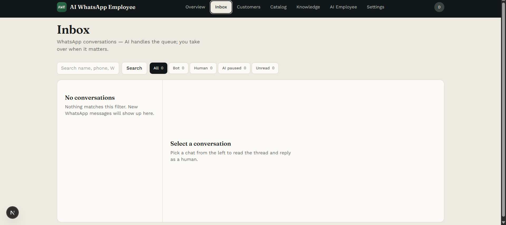
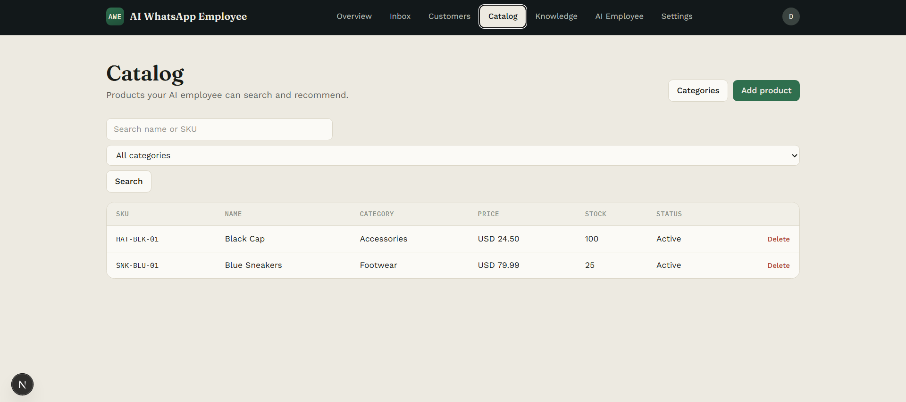
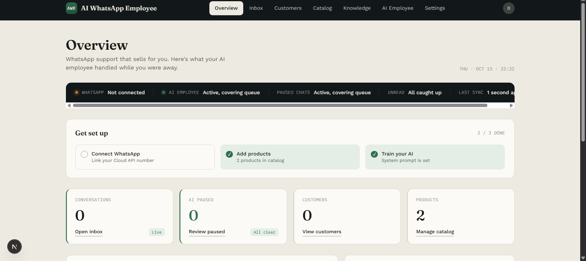

# AI WhatsApp Employee

[](https://github.com/WalidChaabi/ai-whatsapp-employee/actions/workflows/api-tests.yml)

An in-development, Phase 1 multi-tenant application for AI-assisted WhatsApp support and sales. The repository includes a Laravel API and Next.js operator dashboard; the complete messaging and AI flow requires external services and manual integration.

Laravel owns the product. n8n is the WhatsApp automation engine only. Next.js is the operator dashboard.

## Screenshots


*Inbox: conversation filters and the empty state before messages arrive.*


*Product catalog: search, category filtering, pricing and stock.*


*Overview: setup progress and activity counts; WhatsApp is not connected in this capture.*

No AI settings screenshot is included in the repository. These captures show the UI, not evidence of a working end-to-end integration.

## Implementation Status

### Included in this repository

- Sanctum authentication, tenant scoping and owner/agent authorization.
- Dashboard and API code for products, categories, customers, knowledge articles, AI settings and versioned system prompts.
- Inbox code for conversation search/filtering, human replies, escalation, assignment and resuming AI; queued text sending through Meta Graph API.
- HMAC-protected n8n endpoints for message ingress/egress, product and knowledge search, and escalation.
- API tests covering selected tenant-isolation, role-authorization and dashboard-cache behavior. The existing GitHub Actions workflow runs the Laravel test suite with SQLite.

**Verification:** the [Phase 1 checklist](docs/phase1-checklist.md) reports a previously verified live WhatsApp loop. The [wiring guide](docs/n8n-laravel-wiring.md) still contains unchecked integration steps. Current end-to-end operation has not been independently verified for this checkout; API tests and screenshots do not establish external-service integration or production readiness.

### External configuration required

- **Meta WhatsApp Cloud API:** configure an app, phone number ID, access token and webhook to n8n, including webhook verification and Meta signature validation; map the account to a tenant in Laravel.
- **n8n:** configure and activate the ingress → AI/tools → WhatsApp send → egress flow. **No exported n8n workflow is included.** Follow the [runbook](docs/n8n-runbook.md) and [Laravel wiring guide](docs/n8n-laravel-wiring.md); the complete integration does not run out of the box.
- **AI provider:** supply OpenAI or Gemini credentials and configure the provider/model in n8n. Laravel stores AI settings and prompts; provider execution is orchestrated externally.
- **HMAC signing:** set the same `N8N_HMAC_SECRET` in Laravel and n8n. Sign `timestamp.rawBody` with SHA-256 HMAC and send `X-N8n-Timestamp` and `X-N8n-Signature`; GET requests use an empty body.
- **Public API access:** expose Laravel through a reachable HTTPS URL for n8n Cloud and update the workflow base URL when it changes. See the [tunnel checklist](docs/tunnel-checklist.md).

### Known limitations and unfinished work

- Phase 1 automation focuses on text. Audio/image handling requires additional n8n processing or a fallback response, as described in the wiring guide.
- External-service end-to-end test coverage is not included; the API suite does not exercise live Meta, n8n or AI providers.
- A stable demo domain/tunnel, production Horizon access configuration and optional Sanctum SPA cookie/CORS setup remain checklist items. Billing is deferred in the architecture notes.
- The OpenAPI document is a starting specification, not a complete description of all current routes.

## Stack

| Layer | Tech |
|-------|------|
| API | Laravel 12, PHP 8.4, Sanctum, Horizon |
| Web | Next.js 16, React 19, Tailwind CSS |
| Data | MySQL 8.4, Redis 7 |
| Automation | n8n Cloud (external) |
| AI | OpenAI / Gemini |
| Messaging | Meta WhatsApp Cloud API |

## Monorepo layout

```
apps/api      Laravel API (source of truth)
apps/web      Next.js dashboard
infra/docker  Dockerfiles
docs/         Architecture, OpenAPI, n8n runbook
packages/     Shared contracts (optional)
```

## Quick start (Docker)

```bash
cp apps/api/.env.example apps/api/.env
# Set APP_KEY after first api container boot, or run: docker compose run --rm api php artisan key:generate

docker compose up -d mysql redis
docker compose run --rm api composer install
docker compose run --rm api php artisan migrate --seed
docker compose up -d api horizon web
```

- API: http://localhost:8000  
- Web: http://localhost:3000  
- Horizon: http://localhost:8000/horizon (local only; protect in prod)

## Quick start (local without Docker for app code)

Prerequisites: PHP 8.3+/8.4, Composer, Node 20+, MySQL, Redis.

```bash
# API
cd apps/api
composer install
cp .env.example .env
php artisan key:generate
# Point DB_* and REDIS_* at your local services
php artisan migrate --seed
php artisan serve
php artisan horizon

# Web
cd apps/web
npm install
cp .env.example .env.local
npm run dev
```

## Documentation

See [`docs/`](docs/) for the [architecture](docs/architecture.md), [OpenAPI specification](docs/openapi.yaml), [Phase 1 checklist](docs/phase1-checklist.md), [n8n runbook](docs/n8n-runbook.md) and [integration guide](docs/n8n-laravel-wiring.md). Component setup notes: [API](apps/api/README.md) and [web dashboard](apps/web/README.md).

## Security notes

- Dashboard never talks to n8n.
- Internal routes (`/internal/v1/*`) require HMAC (`X-N8n-Signature`).
- Tenant scoping uses `TenantContext`, `BelongsToTenant` and access middleware; selected isolation scenarios are covered by API tests.

## License

[MIT](LICENSE)
